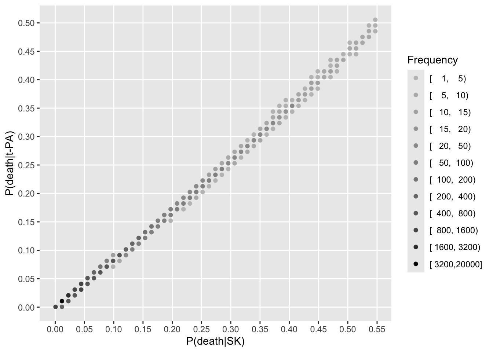
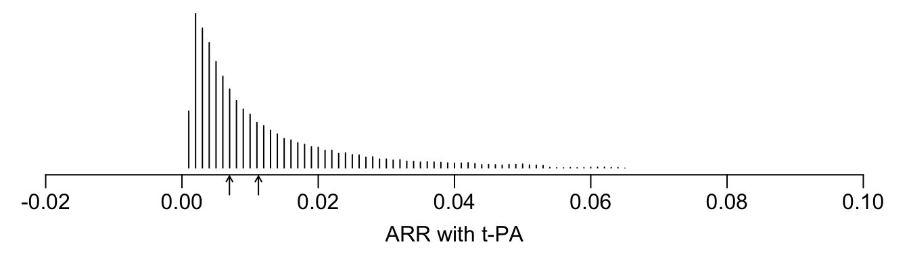
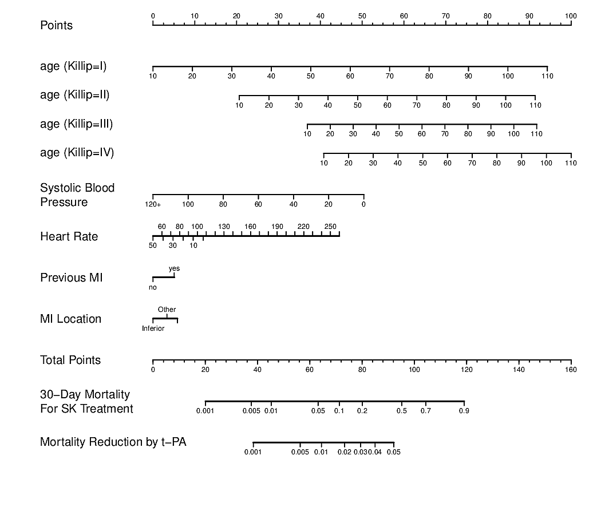

::: {.quoteit}
Goals and estimands should flow from the study design while respecting the lack of exchangeability of the participants and leading to estimators with data-verifiable assumptions.

Statistical models are approximations of reality.  It is not rational to fear transparent assumptions required by them.  Avoiding models will almost surely lead to worse results.

It is impossible to model an individual patient's outcome from cross-sectional or parallel-group designs.  The best we can do is to model outcome _tendencies_.
:::

# Background

Before making a case for the most relevant estimands for traditional clinical trials, we need to introduce estimands, the roles for statistical models, and how the most common randomized clinical trial (RCT) design works.

## Estimands

::: {.quoteit}
Features and estimands should be interpretable in the real world, meaning they are based on an observable process. --- [A Bühler, RJ Cook, JF Lawless 2023](https://onlinelibrary.wiley.com/doi/full/10.1002/sim.9675)
:::

This article considers the key quantities being estimated, i.e., key _estimands_, in an RCT.  It does not consider the _estimands framework_ per se, which often focuses on estimands in complex situations such as non-adherence, dropouts, and unscheduled treatment crossover.  This article focuses on the more classical intent-to-treat analysis of traditional outcomes, without intending to answer "what if" questions such as "what is the treatment effect we expect had all patients adhered to assigned treatment or had none of them died before their final clinic visit?".  Non-adherence is averaged out, and an intent-to-treat analysis estimates differences in outcomes depending on initial treatment assignment.  For an RCT treatment effectiveness estimate to transport to clinical practice, adherence levels observed in the RCT may need to mimic those in clinical practice.  Attempts to adjust for differing levels of adherence requires making untestable statistical model assumptions including assumptions about reasons for non-adherence.

The types of estimands considered here include both absolute and relative measures. Absolute measures include differences in

* means, medians, other quantiles, pseudomedians
* absolute risks
* cumulative incidences
* mean or median time to an event, e.g. gain in life expectancy

Relative measures include

* odds ratios
* risk ratios (more context-dependent than odds ratios)
* hazard ratios
* ratios of means

## Statistical Models

::: {.quoteit}
As long as a model appears to describe the relevant aspects of the world satisfactorily, we may continue, cautiously, to use it; when it fails to do so, we need to search for a better one.  --- [AP Dawid, 2000](https://www.jstor.org/stable/2669377)
:::

Statistical models are approximations of unknown data generating processes.  The fact that they are not perfect does not imply they should be avoided.  Avoiding data models results in oversimplification, lack of transportability of clinical trial findings to clinical populations, reduced utility for individual patient decision making, and overuse of impossible-to-actualize counterfactual thinking.

To find the most efficient estimator of a parameter, i.e., an estimator having the highest probability of being close to the true parameter value, one must have a data generating model that includes a distribution for the response variable.  For that distribution one can derive an optimum estimator in terms of performance measures such as precision and root mean squared error.  The data model also allows for statistical inference, including the calculation of uncertainty intervals.

The data generating model does not have to be perfect.  When the main effect of interest is an experimental condition that was randomized, the data model is allowed to be even more imperfect.

Consider the oldest statistical regression model, the linear model, named from the fact that it is linear in the _parameters_.  Suppose that the outcome variable $Y$ is continuous, and conditional on a vector $X$ of baseline descriptors has a normal distribution. Let $X$ denote a vector of baseline descriptors, $\beta$ a vector of regression coefficients corresponding to them, and $X\beta$ denote their inner product, i.e., $\beta_{1}X_{1} + \beta_{2}X_{2} + ... + \beta_{p}X_{p}$, also called the _linear predictor_. The linear model may be stated as
$$Y = X\beta + \epsilon$$
where $\epsilon$ is a _residual_ or _error term_ having a normal distribution with mean zero.  The linear model is flexible only in allowing $X$ to be expanded to contain nonlinear and non-additive terms (interactions); it is inflexible with regard to the normality assumption for $\epsilon$ and the need for $Y$ to already be properly transformed so that effects of the baseline variables are largely additive and the error term is additive.  Parametric models for continuous $Y$ are very sensitive to these transformations.

Models such as the ordinary multiple regression model above which have an error term have one distinction: When an important predictor is left out of the $X$ vector, its effect is absorbed into the error term $\epsilon$ by making the residuals larger.  When one of the $X$'s such as treatment is uncorrelated with the omitted variable (i.e., treatment assignment is balanced with respect to the omitted variable), the treatment effect estimate is not biased by this omission.  Only power is lost, due to an increase in residual variation.

Statistical models are more general, flexible, and [robust than many researchers believe](https://www.fharrell.com/post/robcov) (see also [this](https://arxiv.org/abs/2107.07278)).  Consider a very general statistical model that is part of the [cumulative probability model](https://hbiostat.org/ordinal) (CPM) family of ordinal semiparametric models.  CPMs are stated in terms of a standardized underlying cumulative probability distribution $F$, [See [this](https://hbiostat.org/ordinal) for a gentle introduction to ordinal models and [this](https://fharrell.com/post/cpm) for more about their unifying powers.]{.aside}
such as the normal distribution (probit ordinal model), the logistic distribution (proportional odds model), and the Gumbel distribution (proportional hazards model).  The ordinal outcome variable $Y$ may be continuous, discrete, a discrete/continuous mixture, or binary.[Discrete/continuous mixtures include continuous responses with clumping at zero and continuous variables with clinical event overrides at the extremes.  Some $Y$ values may be censored.]{.aside}
Note that no assumption is made that $Y$ follows the distribution $F$.  $F$ is chosen because it is monotonically increasing.  Semiparametric models do not make absolute distributional assumptions, only relative ones.  $F$ is the scale on which the $X$ effects are shifted.  For example suppose a probit ordinal model is used and the only $X$ is treatment A vs. B.  Then $F$ is the cumulative normal distribution, and the model assumes that whatever shape the cumulative distributions have for A and B, the normal inverse of their CDFs (cumulative distribution functions) are parallel.  The normal inverse CDFs do not need to be linear, which is required for a standard parametric regression model.  For a Cox semiparametric proportional hazards survival model we want $\log(-\log)$ survival curves to be parallel but do not require them to be linear (as a parametric Weibull model would).

The CPM may be stated in terms of exceedance probabilities:
$$P(Y \geq y | X\beta) = F(\alpha_{y} + X\beta)$$
where $y$ is any of the distinct values of the outcome $Y$, $|$ means "given" or "conditional on", and $\alpha_{y}$ denote a vector of intercepts.  There are as many intercepts as there are distinct $Y$-values occurring in the data, less one.  When the baseline variables $X$ have no effect, $\beta=0$ and the CPM is just a restatement of the empirical cumulative distribution function (ECDF), which is the nonparametric maximum likelihood estimator of the cumulative distribution of $Y$.  When $\beta\neq 0$, a CPM can be thought of as a shifted ECDF.  CPMs are semiparametric because they are parametric with respect to $X\beta$ but make no distribution assumption about $Y$ for any specific $X$.  When $Y$ has only two distinct levels and $F(u)$ is the logistic function $\frac{1}{1 + \exp(-u)}$, the CPM is the binary logistic model.  To make the model more nonparametric with regard to the $X$ effects one can add [regression splines and interaction effects](https://hbiostat.org/rmsc/genreg) inside $X\beta$ so as to not assume linearity or additivity on the linear predictor scale.  To make the model parametric, just make $\alpha_{y}$ be a smooth function that does not adapt to the data.  For the linear model [$\alpha_{y} = \frac{\text{constant} - y}{\sigma}$](https://hbiostat.org/rmsc/cony).[These unitless intercepts pertaining to cumulative probabilities should not be confused with the traditional linear model intercept on the $Y$-scale.]{.aside}

CPMs work perfectly well for [continuous $Y$](https://hbiostat.org/rmsc/cony).  The R `orm` function in the `rms` package has no limit on the number of intercepts.  These intercepts encode the ECDF of $Y$ when $X=0$ and in the Cox proportional hazards model represent $\log(-\log(S_{0}(t)))$ where $S_{0}(t)$ is the underlying survival curve, which is a step function.

Ordinal models in the CPM family have the following as some of their special cases: sample mean and quantiles, Pearson's $\chi^2$ test, $t$-test (two-sample and paired), ANOVA, linear regression, Wilcoxon test, Wilcoxon signed-rank test, Kruskal-Wallis test, ECDF, Kaplan-Meier estimator, Turnbull estimator for interval censored $Y$, logrank statistic, Cox proportional hazards model, and accelerated failure time models.  See [this](https://fharrell.com/post/cpm) for how to analyze the special cases with a CPM.

CPMs are robust to outliers in $Y$ and the parameter values ($\alpha$ and $\beta$) do not change when any monotonic increasing transformation is made to $Y$. $\alpha$ and $\beta$ computed on $Y$ are identical to estimates computed on $\log(Y)$.  CPMs use only the ordering of $Y$ [Until one uses a fitted CPM to estimate the mean of $Y|X$]{.aside} and have such wide applicability and fewer assumptions that they should be on the front line of model choices for RCTs.

CPMs provide a wide number of clinical readouts including cumulative probabilities, survival curves, restricted mean survival time, probability of an outcome at a specific level $y$, effect ratios, and covariate-specific differences in means and quantiles, along with uncertainty intervals.

Unlike the linear model with its $\epsilon$, and omitted predictor can distort the effect of an $X$ even with perfect balance in the omitted covariate across treatments.  This is related to _non-collapsibility of odds and hazard ratios_ which has inappropriately been used to criticize these ratios.  Non-collapsibility is of little concern if alternatives to statistical modeling [make matters even worse](https://www.fharrell.com/post/robcov).  Covariate-adjusting for some baseline variables is better than not covariate-adjusting for any.

Statistical models readily account for differential treatment effect (treatment $\times$ baseline covariate interactions).  Interactions are usually covered up in the causal inference world.

## RCT design

::: {.quoteit}
A clinical trial gains its value, not from representativeness, but from the internal randomisation that ensures that a comparison of between its treated and untreated groups is indeed a comparison of like with like, and that valid probability statements can be made about likely differences, to enforce internal validity. --- [AP Dawid & S Senn](https://arxiv.org/html/2301.11976v2)
:::

Consider a comparison of the therapeutic effectiveness of treatments A and B when a given patient will receive only one of the treatments, at random.  This is a parallel-group randomized clinical trial (RCT) design.  The selection process involved in this classic design is a triple filtration, at least:

* The RCT is advertised, or patients are asked by medical staff about their interest in participating.
* Patients volunteer for participation, for a variety of reasons.
* These volunteers are screened to see if they meet the study's inclusion criteria and don't meet any of the exclusion criteria.
* Those passing the previous screens go through informed consent to be randomized.
* Between the time the formal consent is signed and actual randomization takes places, patients can change their minds and withdraw from the study.  Since randomization hasn't happened yet there are no significant harms to the study other than a reduction in sample size.
* Once a patient is randomized, A or B begin and follow-up starts.
* After randomization, patients may drop out and revoke their consent to even be contacted again.  This may happen before or after treatment actually starts.   Also, some patients may not fully adhere to the assigned therapy.  To deal with these complexities without using complex uncheckable analyses, most RCTs base their pivotal analyses on intent-to-treat or "analyze as you randomize".

RCTs exist to estimate what happens to patients **after** they pass through the multi-phase filtration process described above.  It is a mistake to think that an RCT ever intended to estimate population average responses for a treatment; RCTs do not use random sampling nor probability sampling from a clinical population.  The difference between A and B is the focus.  Depending on how differences are estimated, they may or may not unbiasedly estimate population quantities.  The use of marginal estimators outside of the linear model framework assumes either that the RCT selected patients completely at random from a population (i.e., patients are coerced to take risky experimental therapies) or they are selected under probability sampling and we know the selection probabilities.  These never apply to an RCT.  Marginal treatment effects (especially when absolute measures are being used) computed on patients in an RCT do not transport to a population and are difficult to interpret even within the RCT sample (see [this](https://www.fharrell.com/post/robcov) and [this](https://www.fharrell.com/post/ipp)).

RCTs [do not mimic clinical practice](https://www.fharrell.com/post/rct-mimic) nor should they.

A very important point routinely missed by practitioners of causal calculus is that even with strict inclusion criteria, most RCTs still randomize patients with a wide prognostic spectrum.  This heterogeneity of outcome tendencies means that patients are not exchangeable, and when the underlying statistical model is not linear, marginal estimates of absolute effects may not apply to any patient in the trial, and they cover up [extreme heterogeneity of absolute treatment effects](https://www.fharrell.com/post/varyor).  In the so-called age of precision/personalized medicine, marginal estimates are instead highly depersonalized.

# Conceptualizing Clinical Questions in an RCT

::: {.quoteit}
... the meaningfulness of a purportedly scientific theory, proposition, quantity, or concept is related to the implications it has for what is or could be observed, and in particular, to the extent to which it is possible to conceive of data that would be affected by the truth of the proposition or the value of the quantity.  When this is the case, assertions are empirically refutable and are considered "scientific."  When this is not so, they may be branded "metaphysical."  I argue that counterfactual theories are essentially metaphysical.  This in itself might not be automatic grounds for rejection of such a theory, if the causal inferences that it led to were unaffected by the metaphysical assumptions embodied in it.  Unfortunately, this is not so, and the answers the approach delivers to its inferential questions are seen, on closer analysis, to be dependent on the validity of assumptions that are entirely untestable, even in principle.  This can lead to distorted understandings and undesirable consequences. --- [AP Dawid, 2000](https://www.jstor.org/stable/2669377)

For inference about the effects of causes, a straightforward "black box" decision-analytic approach, based on models and quantities that are empirically testable and discoverable, is perfectly adequate. --- [AP Dawid, 2000](https://www.jstor.org/stable/2669377)

Imagining what we could know or do, if only we had more information that we actually do have, gets us nowhere. --- [AP Dawid & S Senn](https://arxiv.org/html/2301.11976v2)
:::

There are at least three ways to conceptualize the fundamental clinical question, the first being a counterfactual approach.

1. For a patient who received treatment A, would she have gotten a different outcome had she received treatment B instead?
2. Does a group of patients randomized to A have a different mean response than a group randomized to B?
3. Do patients starting at the same place except for treatment end up in the same place?

Outside of crossover designs (not covered here), option 1 is not tied to any data so its assumptions and analytical methods based on it are unverifiable.  This is an individual-patient counterfactual question.  This question does not need to be answered to choose a treatment prospectively and is not identified by parallel-group RCT data under any analytic framework.

Because of heterogeneity of ages, severity of disease, and other prognostic factors across patients within treatment group, option 2 is not as relevant to clinical practice as it seems.  The question is stated as if patients all given the same treatment are exchangeable.  They are not.

# The Fundamental Question in an RCT

I submit that option 3 above, when made more precise, is the main question of interest in parallel-group RCTs.  It uses standard or flexible statistical models and is completely linked to data, so the fit of the model needed to answer the question can be checked.  But we need to more precisely word this option.  We could wish for what many causal inference advocates emphasize: [individual response to treatment](https://discourse.datamethods.org/t/individual-response).  But without a crossover study we cannot begin to discuss [individualized responses](https://www.bmj.com/content/329/7472/966).  And we must recognize that patient responses are not intrinsic because they have a strong random component (sorry about that, potential outcomes).  When assessed frequently enough you will see a [variety of responses](https://onlinelibrary.wiley.com/doi/10.1002/sim.6739) within one patient.  So thinking about patient-specific treatment differences in a parallel-group design is not fruitful.  Instead, emphasize (1) treatment differences within patient *types* and (2) outcome _tendencies_ instead of individual outcomes.  The fundamental clinical question becomes:

For a given patient type, what is the difference in outcome tendencies for such patients assigned treatment A vs. those assigned treatment B?

This question is completely concordant with a parallel group design, and is completely informed by the observed data.  We have to be clear on _patient type_.  By that we mean a patient having a combination of characteristics contained in $X$.  For patient characteristics not contained in the study's measured covariates $X$, we mean the comparisons to apply in the case where all other important (prognostic) characteristics are equal.  So the fundamental question can be re-phrased as the following.  Keep in mind the statistical model's role as an interpolator to estimate outcome tendencies for a large variety of covariate combinations $X$ (e.g., age=60, sex=female, severity of disease=19) even when their exact values are not observed in the RCT data.

::: {.callout-note title="Fundamental Clinical Question"}
For patients with a given combination of characteristics $X$, if we could _assign_ treatment A to one such patient and B to another patient of the same type---all else about them being equal---what is the difference in their outcome tendencies?
:::

Randomization allows us to include "all else being equal" and to read this as the effect of _assigning_ treatment, not merely of observing outcomes of patients who happened to get these treatments.  I deliberately say _assign_ rather than _give_ or _receive_. A clinician can assign a treatment; she cannot compel a patient to adhere to it. This is not a minor wording choice — it is what ties the patient-type estimand to the intention-to-treat principle: the target throughout this article is the effect of the assignment, not of treatment actually received. [As discussed [here](https://fharrell.com/post/causal), when one wants to estimate a treatment effect among adherers, causal calculus is necessary.]{.aside}

Consistent with each patient in a parallel-group design getting only one treatment, the estimand arising from this phrasing of the fundamental question is a *patient-type* estimand.

The _tendency measure_ will have to be chosen, e.g., differences in means, pseudomedians, medians and other quantiles, risk, cumulative incidence, restricted mean survival time, time spent in good functional status, or relative tendencies such as odds or hazard ratios.  [CPMs can provide both absolute and relative measures.]{.aside}

A *key to understanding* the fundamental question is understanding the dimensionality of the parameters involved for inference and estimation.  This will be described below.

# Statistical Estimands to Answer the Fundamental Clinical Question

::: {.quoteit}

Think of a model as an interpolator and a smoother that accounts for easy-to-explain outcome heterogeneity (from patients being unlike each other) and that provides useful and parsimonious estimates of treatment effects that apply to patients.  These estimates are individualized to within the resolution of measured patient characteristics.  The choice of the general model structure is dictated by the study design and must be concordant with it.

:::

## General Model and Its Underlying Model Parameters

For a binary, ordinal, continuous, or mixed univariate outcome variable $Y$ consider the following semiparametric model.  Define the following sets of baseline characteristics:

* $X$: patient characteristics other than treatment that are thought to be predictive of $Y$, collected in the RCT, and used for covariate adjustment
* $T$: treatment assignment ($T=0$ for A, $T=1$ for B)
* $Z$: subset of $X$ that may interact with treatment (differential $T$ effect with respect to $Z$)
* $U$ baseline variables that are predictive of $Y$ but were not included in $X$

The most important variable to include in $X$ is a time zero assessment of $Y$.  If this is not the severity of the disease being studied, then severity of disease at baseline is also important to include.

Now consider the CPM semiparametric regression model:
$$P(Y \geq y | X, T, Z, U) = F(\alpha_{y} + X\beta + \gamma T + T\times Z\delta + U\tau)$$
where $F$ is a suitably chosen distribution family. [Often $F$ is the logistic or Gumbel CDF to make parameters more interpretable as odds or hazard ratios. [Deviance can be used](https://hbiostat.org/rmsc/ordsurv) to choose the best fitting link function ($F^{-1}$).]{.aside}

On the fundamental model-building parameter scale, the treatment effect is $\gamma$ when $Z$ is absent or $\delta=0$.  Otherwise the A$\rightarrow$ B treatment effect on the linear predictor scale (e.g., log odds) is $\gamma + Z\delta$.  This treatment effect is a "rung-2" quantity in [Judea Pearl's causal calculus](https://www.amazon.com/Book-Why-Science-Cause-Effect/dp/046509760X).  That's because $\gamma$ and $\delta$ are estimated from a randomized trial in which Pearl's _do-operator_ was actually executed; it is genuinely causal and not just associational. [Technical detail: if the model is extended to allow for $Y$-dependent effects, e.g., time-varying hazard ratios in a proportional hazards model, the treatment effect on the linear predictor scale will be a function of time and will not be an intent-to-treat causal estimand.  The model will have to be translated e.g. to cumulative incidence or mean restricted survival time to get intent-to-treat estimands.]{.aside}  Pearl's _rung 3_ of causation, the counterfactual rung, does not ask what the treatment does for a patient of a certain type, but what would have happened to a _certain patient_, already observed under one treatment, had they received the other.  To draw actionable causal conclusions from a clinical trial, one can use a purely non-counterfactual decision-theoretic approach as so elegantly argued by [Philip Dawid](https://www.jstor.org/stable/2669377) and [Dawid and Senn](https://arxiv.org/html/2301.11976v2).  That approach is more in line with what is presented here.

The patient-type estimand advocated here is not a retreat from causality.  It jumps off of Pearl's hierarchy one step short by not trying to deal with unobservables.

Since $U$ is unknown we have to pretend operationally that $\tau = 0$.  So our estimates will be marginalized over $U$.  Interestingly, if there are repeated measures for each patient, one can add patient-specific random intercepts to the model to absorb the effect of unmeasured covariates $U$.  Having a baseline version of $Y$ in the model often accomplishes the same thing.

Only a minority of RCTs are sufficiently sized to have excellent power to detect a true minimum clinically important difference even in the absence of interactions.  Almost no RCTs are sized to allow for differential treatment benefit.  So $Z$ and $\delta$ will usually be omitted, i.e., interactions are assumed to be absent, and if they are not, treatment effects are averaged over levels of interacting factors.  Note that all of these complexities, often used to criticize models by those not liking regression models, are not well handled by any of their alternatives.  The beauty of models is that they expose assumptions, provide efficient and accurate results when assumptions are reasonably well satisfied, and the assumptions can be checked with data and model enhancements made when there is a meaningful lack of fit.  Were an analyst to fit interaction terms that are not well-supported by data, uncertainty intervals would be [appropriately wide](https://fharrell.com/post/ia) to reflect this. [Alternatively, Bayesian shrinkage priors or penalized maximum likelihood estimation can be used to account for interactions without overfitting.  In [this large RCT example](https://www.fharrell.com/post/varyor) the optimum penalty for interaction terms was $\infty$ indicating amazing constancy for the odds ratio for treatment.]{.aside}

::: {.callout-note}
## Dimensionality is a Key to Understanding
To fully understand what is going on with statistical models used to infer treatment effectiveness and to estimate patient-type-specific effectiveness one must understand the dimensionality of the problem and how that dimensionality depends on the goal.  Think of dimensionality as degrees of freedom and remember that knowing and accounting for the actual degrees of freedom allows for honest assessment of uncertainties and avoidance of cherry picking (including the neverending search for _subgroups_).  Suppose that $X$ contains $p$ columns and $Z$ has $q$ columns, $q \leq p$.  $Z \delta$ describes differential treatment benefit (interactions) on the linear predictor (LP, e.g., log odds) scale.  When $q=0$, no interactions are allowed.  Here are the dimensionalities involved with different general and specific goals.

| General Goal | Patient Type | Dimensionality | Comment |
|-----|-----|------|------|
| A$\neq$ B | $Z$ | 1 | effect for a specific value of interacting factor |
| A$\neq$ B | all | $1 + q$ | does an effect exist for any patient type |
| Magnitude of B-A effect on a clinical scale | $X, Z$ | $p + 1 + q$ | e.g. absolute treatment benefit for patient type $X$ |

Inference for nonzero effects can be done strictly on the LP scale, because absolute differences are zero if and only if relative (LP) differences are zero.  Estimation of magnitudes on meaningful scales (absolute risk reduction, gain in life expectancy, etc.) carries along parameters used to estimate $X$ and $Z$ effects.

:::

## Clinical Scale Treatment Effectiveness Estimands

Once a flexible and efficient Bayesian or frequentist model is fitted on the RCT data, one immediate gets differences on the linear predictor scale.  Except for the case where $F$ is the cumulative normal distribution and the cumulative probability intercepts $\alpha_{y} = \frac{\text{constant} - y}{\sigma}$ ($\sigma$ being the residual standard deviation), where the model is parametric and instantly provides differences in mean $Y$, one is usually interested in translations of the model to a scale that is more relevant to patients and clinicians.  Suppose the fitted model is $$P(Y \geq y | X, T, Z) = F(\alpha_{y} + X\beta + \gamma T + T\times Z\delta) = F(f(X, T, Z))$$ with $f$ denoting the linear predictor and parameter estimates (e.g., maximum likelihood estimates) inserted for the Greek letters.  Transformations to clinical readouts can be written as $g(f(X, T, Z))$.  When this is nonlinear, the effects of baseline covariates $X$ and $Z$ will not be separable from the effect of $T$ even in the absence of interactions.  For that reason, estimates coming from nonlinear functions of $f$ must be *covariate-specific*.  See [this](https://hbiostat.org/rmsc/cony) for concrete examples of $g$.

As examples, a special case of CPMs is the proportional odds ordinal logistic model.  It directly estimates cumulative probabilities, and from these one can solve for which intercept $\alpha_y$ yields any given cumulative probability.  Then the value of $y$ that corresponds to that intercept is looked up and this is the estimate of a quantile of $Y | X,Z$.  Successive differences of the cumulative probabilities are cell probabilities, and a sum of these probabilities weighted by all the distinct $Y$ values estimates the mean of $Y | X,Z$.  This is done for each treatment, and the needed differences computed.  Bayesian modeling provides exact uncertainty intervals for such differences using the posterior samples already drawn.  For frequentist modeling one uses the bootstrap or the $\delta$-method to get confidence intervals.  For cumulative incidences or survival probabilities, $g = F$ so things are particularly simple.

To reinforce the need for covariate-specificity, remember that low-baseline-risk patients have little room to move, and those at moderately high risk have the most room for risk movement.  When the clinical scale is absolute risk, this means that [risk magnification](https://www.fharrell.com/post/varyor) must be taken into account.  RCTs as typically reported pretend this doesn't exist, and only provide crude average marginal risk differences that not only may not apply to future patients but may not even apply to any patient who was randomized.

How should the results of clinical trials be reported when results are covariate-specific?  Two approaches come to mind:

* choose representative covariate combinations and provide treatment effect estimates and uncertainties for each
* estimate differences for all patients in the RCT and show the entire distribution

When there are continuous predictors, typically every person in the RCT will have different estimated values.  So we have $n$ estimands and estimates for $n$ patients!  This is not a problem, and a high-resolution histogram showing this distribution will honestly portray expected treatment effects.

When interactions are present, the true dimensionality of these $n$ estimates is one plus the number of columns in $Z$.  When there are no interactions, there is effectively only one effectiveness parameter for inference even with $n$ manifestations of differences.  This is because the differences (e.g., absolute risk reductions) are zero if an only if $\gamma = 0$.  For a proportional odds model, for example, the treatment odds ratio is 1.0 if an only if all estimated risk reductions are 0.0.  So evidence for effectiveness concentrates the power into a one degree of freedom test when there are no interactions.

Here is an example of the distribution of estimated absolute risk reductions from the 41,000 patient [GUSTO-I trial of tissue plasminogen activator vs. streptokinase](https://www.fharrell.com/post/varyor) for acute myocardial infarction.  A binary logistic model was used to estimate 30-day mortality.  Estimates are made for all patients in the trial, first setting treatment to streptokinase then to $t$-PA.  First, show the estimated 30-day mortality under $t$-PA vs. under streptokinase.  Clearly apparent is that the RCT is dominated by a very large number of low-risk patients for whom absolute risk reduction is minimal.

Next examine a histogram of the estimated patient-type-specific absolute risk reductions.

Vertical arrows depict the median (left) and mean (right) absolute risk reductions.  The marginal difference in risks is not representative of patients in the trial, and gives heavy weight to the minority of high-risk patients.  The median risk reduction (not estimable without a model) is more representative of what patients should expect to benefit.

Either or both of the graphs are excellent effectiveness summaries that fully document the variety of prognoses of the randomized patients which leads to the variety of effectiveness estimates when using an absolute scale.

A simple nomogram allows patient-type-specific estimates of absolute risk reduction to be easily calculated.

# Celebrate Incorrect Statistical Models

::: {.quoteit}
Far better an approximate answer to the right question, which is often vague, than the exact answer to the wrong question, which can always be made precise – John Tukey

One person's way of doing something is usually better than another person's way of not doing it.

Critics who worry about wrong models make things worse by their fix.

A critic who says "your logistic model with $X$ included could be distorted by an omitted variable $U$" is making a claim that requires knowing $U$ exists and roughly how it behaves — information neither you nor the critic's alternative estimator actually has. If their proposed fix is an unadjusted or marginal analysis, that estimator doesn't use $U$ either. So the critique can't be "I have more information and can do better with it" — nobody has $U$. The critique, stripped of its rhetorical force, reduces to: given the same information you have, I'd process it differently. That's a legitimate methodological debate, but it's a different and much narrower claim than "your model is unreliable because of what it's missing." The right response is to ask what their alternative actually buys you given the same ignorance of $U$.
:::

Proponents of causal calculus criticize assumptions made by nonlinear statistical models (despite often being unaware of distribution-free semiparametric ones) and seek to constantly invent new approaches such as doubly-robust estimators, targeted maximum likelihood estimation, machine learning-based incorporation of covariates, and [$G$-computation](https://academic.oup.com/ije/article/46/2/756/2760169). Critics of more standard statistical models tend to put a lot of emphasis on bias and little emphasis on mean squared errors or individual-patient clinical decision making.  [Users of $G$-computation](https://fharrell.com/post/ipp) free themselves of assumptions about treatment $\times$ covariate interactions and robustify inference by effectively allowing for all possible treatment $\times$ covariate interactions but then sweeping such interactions under the rug by estimating marginal (non-covariate-conditional) treatment effects.  This is often done by fitting separate logistic regressions in the two treatment groups, estimating the treatment-related risk difference for each patient, then averaging these differences over all patients.  The incredible instability in per-patient estimates is averaged out.  This results in reduced variance on the risk scale but at the great cost of *changing the question*.  This approach, besides hiding whatever interactions may be present, jettisons some of the richest information in a study: the prognostic spectrum and its relationship to absolute treatment benefit, demonstrated in the graphs above.  This has direct implications in how treatments are used in practice.  Expensive or dangerous treatments should be reserved for patients with larger absolute benefits.  [Counterfactual-based attempts at individual patient decision making have [led to nothing but confusion](https://arxiv.org/html/2301.11976v2).]{.aside}  Marginal estimates do not transport to clinical populations and do not compare in value to patient-type-specific estimates.

## Missing Covariates

One of the criticisms of nonlinear statistical models is that due to non-collapsibility, failing to adjust for the hidden outcome heterogeneity caused by unmeasured covariates distorts estimates and inference related to parameters for treatment and measured covariates.  Let's study this in a very simple situation where the response variable $Y$ is binary, there are two treatments ($T=0$ for A, $T=1$ for B), one binary measured covariate $X$, and one binary unmeasured covariate $U$.  Suppose the true model is $P(Y=1 | X,T,U) = \text{expit}(-1 + X + T + U)$ where $\text{expit}(u) = \frac{1}{1 + \exp(-u)}$.  Make these correlations zero: $X$ vs. $T$, $U$ vs. $T$, $U$ vs. $X$.  Regression coefficients are all 1.0.  Consider two approaches:

* modeler: fit the above model without the unavailable $U$ and proceed as usual
* critic: relax assumptions using any estimation technique desired with the goal of estimating the effect of $T$ marginalized over both $X$ and $U$.  $G$-computation can be used for variance reduction for the final contrast.  Patient-type resolution is traded for a sample-level quantity.

Here are infinite $n$ results for odds ratios(ORs). [In the table "Uses neither $X$ nor $U$" refers to the marginal risk difference estimand, not the variance estimator.]{.aside}

: Relative scale (log-odds-ratio) {#tbl-logor}

| Estimate | Uses | log-OR | Bias vs. true 1.000 |
|---|---|---|---|
| True effect | X and U | 1.000 | — |
| Modeler's additive model (T + X, U omitted) | X only | 0.947 | −0.053 |
| Critic, fully marginal | neither X nor U | 0.899 | −0.101 |

Using the one available covariate with $U$ missing — cuts the bias from omitting relevant covariates roughly in half (0.101 down to 0.053). This is not from correctly specifying anything about $U$; it is simply what conditioning on measured predictors does to a non-collapsible measure.

Here are the results for the absolute risk difference due to treatment.

: Absolute scale (risk difference) {#tbl-rd}

| Estimate | Value | Target | Bias |
|---|---|---|---|
| Modeler, $X=0$ | 0.2323 | 0.2311 (true, $U$-averaged) | +0.0012 |
| Modeler, $X=1$ | 0.1891 | 0.1904 (true, $U$-averaged) | −0.0013 |
| Critic, fully marginal | 0.2107 | — | — |

On the risk-difference scale, the modeler's additive-model estimates are not perfectly unbiased for the $X$-specific truth — forcing additivity on $T$ and $X$, when U's marginalization technically induces a small $X\times T$ interaction on the logit scale [Adding an $X\times T$ interaction in the small model that did not exist in the full model would have made the $X$-specific risk differences be exactly unbiased.]{.aside}, leaves a residual bias of about 0.001 in each stratum. That residual is roughly fifteen to seventeen times smaller than the gap between the critic's single marginal number (0.2107) and either patient type's true absolute benefit (0.2311 for $X=0$, 0.1904 for $X=1$). The critic's number is not biased as an estimate of the population-average risk difference — it equals (0.2311+0.1904)/2 exactly, a consequence of linearity of expectation that holds regardless of the underlying model's nonlinearity. It is, however, the wrong number for every actual patient, by an amount well over an order of magnitude larger than what the simple additive model adjusting only for $X$ leaves on the table.

## Missing Covariates and Mismodeled Measured Covariates

In [Incorrect covariate adjustment may be more correct that adjusted marginal estimates](https://www.fharrell.com/post/robcov) I provide several relevant examples.  First consider transportability of risk differences.  In one example a marginal estimate computed as an 0.087 increase in risk among trial participants averaging age 70 becomes 0.130 in a simulated younger, more-female population — the same fitted model, the same treatment effect, but a materially different marginal number once the covariate distribution changes, because the marginal estimand is a function of whichever covariate values happened to enroll.  Marginal estimands are sample-specific.

Next consider inference under an ill-fitting model. An example is presented in the above reference article which simulated treatment contrast's Type I assertion probability $\alpha$ for a misspecified linear-in-age, sex-omitted model came out essentially at or slightly below the nominal 0.05 level, and simulated power to detect a true OR of 1.75 was 0.812 for the misspecified model versus 0.813 for the correctly specified model — a negligible difference.

See also [White _et al_](https://arxiv.org/abs/2107.07278).

# Summary

A general way of stating the fundamental clinical question was given that is completely concordant with parallel-group RCTs and with clinical decision making and does not involve unobservable quantities.  Standard models, or even better, distribution-free semiparametric models, directly answer this fundamental question.  This has several downstream ramifications, including the creating of the best framework for assessing differential treatment effects (interactions on a scale for which such effects are allowed to be zero when the treatment has an overall positive effect), handling partial information, and analyzing arbitrarily censored data and longitudinal data.  Statistical models also form the bridge between frequentist and Bayesian approaches, the latter providing exact inference and providing a formal mechanism for incorporating external information.  Statistical models are more robust than thought by critics, and their assumptions involve observable quantities so are capable of being critiqued.  And models can be formulated to be fully concordant with the experimental design.

# Further Reading

* [Causal infererence without counterfactuals](https://www.jstor.org/stable/2669377) by A.P. Dawid
* [Personalized decision-making without counterfactuals](https://arxiv.org/html/2301.11976v2) by A.P. Dawid and Stephen Senn
* [Individual response to treatment: is it a valid assumption?](https://www.bmj.com/content/329/7472/966) by Stephen Senn
* [Mastering variation: Variance components and personalized medicine](https://onlinelibrary.wiley.com/doi/10.1002/sim.6739) by Stephen Senn
* [Discussions about individual response to treatment](https://discourse.datamethods.org/t/individual-response)
* [Seven myths of randomization in clinical trials](https://onlinelibrary.wiley.com/doi/10.1002/sim.5713) by Stephen Senn
* [Prediction can be safely used as a proxy for explanation in causally consistent Bayesian generalized linear models](https://www.tandfonline.com/doi/full/10.1080/00949655.2024.2449534) by Maximilian Scholz & Paul-Christian Bürkner
* [What Is the ITT Estimand Anyway?](https://analytixthinking.blog/2026/07/24/blog-27-estimands-part-3b-what-is-the-itt-estimand-anyway) by Steve Ruberg
* [Multistate models as a framework for estimand specification in clinical trials of complex processes](https://onlinelibrary.wiley.com/doi/full/10.1002/sim.9675) by A Bühler, RJ Cook, JF Lawless
* [The Book of Why](https://www.amazon.com/Book-Why-Science-Cause-Effect/dp/046509760X) by J Pearl & D Mackenzie
* [Randomized clinical trials do not mimic clinical practice, thank goodness](https://www.fharrell.com/post/rct-mimic)
* [Causal by design](https://fharrell.com/post/causal)
* [Incorrect covariate adjustment may be more correct than adjusted marginal estimates](https://www.fharrell.com/post/robcov)
* [Covariate adjustment in randomised trials: canonical link functions protect against model mis-specification](https://arxiv.org/abs/2107.07278) by IR White, TP Morris, E Williamson
* [Analysis of covariance in randomized studies](https://hbiostat.org/bbr/ancova)
* [Implications of interactions in treatment comparisons](https://www.fharrell.com/post/ia)
* [Has modelling killed randomization inference?](https://www.slideshare.net/slideshow/has-modelling-killed-randomisation-inference-frankfurt-251045286/251045286) by Stephen Senn
* [Resources for ordinal regression](https://hbiostat.org/ordinal)
* [Resources for clinical trial endpdoints](https://hbiostat.org/endpoint)
* [Bayesian methods resources](https://hbiostat.org/bayes)
